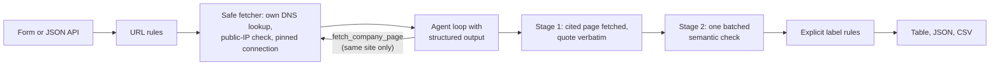

# Company Screening Assistant

Screens up to ten company websites against your criteria (industry, geography, target
business, exclusions) with an LLM, and shows only facts that are backed by verbatim quotes
from the fetched pages.

> **Educational prototype — not financial or investment advice.** The evaluation data is
> synthetic; nothing in this repository measures accuracy on real companies.

## What it does

1. You enter up to 10 URLs and the criteria, in a web form or through a JSON API.
2. The app fetches each homepage over plain HTTP(S), with SSRF protection.
3. Claude (one model, `claude-sonnet-5-5` by default) reads the page text, either through
   the Anthropic API or through a local Claude Code login (see
   [Backends](#backends)). It may call one tool, `fetch_company_page`, to read other pages
   of the **same** site, and must answer with a JSON object that matches a schema
   (structured output).
4. Every fact is checked. Code verifies that each quote is verbatim on a fetched page; a
   second, batched check confirms that the quote actually states the claim.
5. Unsupported facts are removed, and the label — `fit`, `non_fit` or
   `insufficient_information` — is recomputed by explicit rules.
6. Results appear in a table and can be exported as JSON or CSV.



More detail: [docs/architecture.md](docs/architecture.md).

## Quick start

Requires Python 3.12 and [uv](https://docs.astral.sh/uv/).

```bash
uv sync
uv run pytest                                              # no network, no API key
uv run uvicorn screener.web:create_app --factory --reload  # http://127.0.0.1:8000
```

The default is **mock mode**: a deterministic stand-in for the model built from keyword
rules. It needs no API key and costs nothing. It exists for development and CI and says
nothing about the quality of a real model; the UI shows a "Mock mode" badge.

## Backends

Choose one with `LLM_BACKEND`, in a local `.env` file (git-ignored, see `.env.example`)
or an environment variable. A backend never switches to another one on its own.

| `LLM_BACKEND` | Model | Billing | Use it for |
|---|---|---|---|
| `mock` (default) | none: keyword rules | free | development, tests, CI |
| `claude_code` | Claude through your local Claude Code login | your Claude subscription: usage limits, no per-token charge | personal local runs and evaluation |
| `anthropic` | Claude through the Anthropic API | pay per token (`ANTHROPIC_API_KEY`) | a deployed demo, API evaluation |

### Using your Claude subscription (`claude_code`)

Requirements:

- Claude Code installed and logged in with your subscription; open it once and sign in.
- The optional extra, which brings the Claude Agent SDK and its bundled CLI:

```bash
uv sync --extra claude-code
# .env
LLM_BACKEND=claude_code
LLM_MODEL=claude-sonnet-5-5   # optional
```

How it behaves:

- The app does not read credential files; Claude Code uses its own login.
- If `ANTHROPIC_API_KEY`, `ANTHROPIC_AUTH_TOKEN`, `ANTHROPIC_BASE_URL` or a cloud-provider
  variable is set, Claude Code would use it instead of the subscription and could bill the
  API, so the backend refuses to start.
- The agent runs inside Claude Code with everything else switched off:
  - no built-in tools (no shell, files or web);
  - none of your MCP servers, settings, hooks, plugins or CLAUDE.md files;
  - no session saved to disk.

  Its only tool is the app's `fetch_company_page`, with the same validation and SSRF
  protection. `--bare` is not used, because it ignores the subscription login.
- Limits: turns per run (`CLAUDE_CODE_MAX_TURNS`), a timeout per run
  (`CLAUDE_CODE_TIMEOUT_S`) and one Claude Code process at a time
  (`CLAUDE_CODE_CONCURRENCY`).
- When the subscription's usage limit is reached, or paid overage would start, the run
  stops with a message that names the limit window and its reset time. Nothing falls back
  to the API.

> **Personal, local use only.** Anthropic does not allow offering claude.ai login or
> subscription rate limits in products for other people. A public demo must use the
> `anthropic` backend (or `mock`), never your subscription.

### Using the Anthropic API (`anthropic`)

```bash
LLM_BACKEND=anthropic
ANTHROPIC_API_KEY=...        # never commit this
```

Every request is billed and counts against the limits described below.

## Example

`POST /api/screen` with a synthetic company from the evaluation set:

```json
{
  "urls": ["https://marisol-valvulas.example/"],
  "criteria": {
    "industry": "industrial valves",
    "geography": "Germany",
    "target_business": "Manufacturer of industrial valves or other flow-control equipment",
    "exclusions": "pure distributors or resellers; companies owned by private equity firms"
  }
}
```

The page says: *"Headquartered in Valencia, Spain, we export to customers across Europe,
including Germany and France."* Response, shortened. It was produced in mock mode, so it
shows the format, not model quality:

```json
{
  "status": "ok",
  "company_name": "Marisol Valvulas",
  "fit": "non_fit",
  "model_fit": "non_fit",
  "decision_note": "Rules after evidence checks: industry met, geography not_met, business met, exclusion not triggered -> non_fit.",
  "company_locations": ["Valencia", "Spain"],
  "markets_served": ["Europe"],
  "evidence": [
    {
      "supports": "description",
      "quote": "Marisol Valvulas manufactures industrial gate and globe valves for the oil and gas industry.",
      "url": "https://marisol-valvulas.example/",
      "check": "supported"
    }
  ],
  "warnings": [],
  "usage": {"llm_requests": 2, "failed_requests": 0, "input_tokens": 1801, "output_tokens": 514}
}
```

Exports: `GET /runs/{id}/export.json` and `GET /runs/{id}/export.csv`. The CSV is
protected against formula injection.

## Configuration

All settings are environment variables; `.env.example` lists every one with its default.

| Setting | Default | Meaning |
|---|---|---|
| `LLM_BACKEND` | `mock` | `mock`, `claude_code` (subscription) or `anthropic` (API) |
| `LLM_MODEL` | `claude-sonnet-5-5` | one model for the agent and the evidence check |
| `LLM_EFFORT` | `low` | effort level sent to the API |
| `MAX_TOOL_CALLS` / `MAX_LLM_CALLS` | 3 / 4 | tool calls and agent turns per company |
| `MAX_LLM_REQUESTS_PER_COMPANY` | 8 | every API attempt, including retries and the check |
| `MAX_TOKENS_PER_COMPANY` / `_PER_RUN` | 80,000 / 600,000 | token budgets, reserved before each call |
| `MAX_URLS_PER_REQUEST` | 10 | URLs per screening |
| `MAX_ACTIVE_RUNS` / `MAX_STORED_RUNS` / `RUN_TTL_S` | 2 / 50 / 7200 | in-memory job limits |
| `DEMO_ACCESS_TOKEN` / `PUBLIC_DEMO` | empty / `false` | access token for every page and the API; `PUBLIC_DEMO=true` makes it mandatory |
| `RUNS_PER_IP_PER_HOUR` / `DAILY_MAX_COMPANIES` / `DAILY_MAX_TOKENS` | 10 / 200 / 2,000,000 | demo abuse and spending limits |

## Evaluation

The synthetic set in [`eval/cases`](eval/cases) has 20 invented companies on reserved
`.example` domains (6 `fit`, 9 `non_fit`, 5 `insufficient_information`), including traps
such as markets mistaken for locations, trade fairs, indirect signals (phone codes,
currency), visible and hidden prompt injection, and an off-site redirect. Expected answers
were committed before any live run and still need human review. See
[eval/README.md](eval/README.md).

```bash
uv run python -m screener.evaluate --mode mock                                             # free pipeline check
uv run python -m screener.evaluate --mode claude-code --only 01-valves-fit-homepage --yes  # real model, subscription
uv run python -m screener.evaluate --mode api --only 01-valves-fit-homepage --yes          # real model, API (paid)
```

Pages always come from the saved files, with every backend. A real-model run prints its
limits first and does not start without `--yes`. Reports include schema-valid rate,
accuracy, macro-F1, a confusion matrix, fact checks, time and tokens. Each report also
states the backend and how it is billed:
- a cost for the API, at explicitly listed tariffs;
- for Claude Code, "no per-token charge" plus an API-equivalent figure that is clearly
  marked as an estimate, not a charge.

**Current results.**
- **Mock run:** 13/20. It only shows that the pipeline works end to end; keyword rules
  are not a model.
- **Claude Code, full set** (2026-11-25, `claude-sonnet-5-5`, effort `low`):
  - 20/20 correct final labels, all answers schema-valid, no invented locations;
  - median 12 s per case, 81 model requests;
  - API-equivalent estimate $0.46 for the set. That is not a charge: the run used the
    subscription.

  The first full run stopped after 14 cases, all correct, because of a budget bug in the
  evaluation runner. The bug was fixed and the set run again.

  This is a pipeline check on easy synthetic pages written alongside the prompts. It is not
  an accuracy estimate for real companies.
- **API backend:** not run yet (no API key).

Details: [docs/evaluation.md](docs/evaluation.md).

## Security and cost controls

- **SSRF.** http/https on default ports only; no IP literals, `localhost`-style or reserved
  names. The app resolves DNS itself, requires every address to be public, and connects
  to the checked IP while TLS still verifies the host name. Redirects are re-checked on
  every hop, and proxy variables are ignored.
- **Prompt injection.** Page text is treated as untrusted data. The `<page>` delimiters
  are not a security boundary, so the real limits are elsewhere: one narrow tool whose
  arguments are validated by code, same-site fetching after redirects, hard limits on
  turns, tool calls and tokens, verbatim quote checks, and labels computed by code.
- **Budgets.** Every API attempt counts against per-company and per-run budgets: agent
  turns, the evidence check and retries. The worst case is reserved before each call.
  Temporary errors are retried by the app, not the SDK, so each attempt is visible. A
  provider spend-limit error is never retried and stops the run.
- **Output.** HTML is escaped, only `http(s)` URLs become links, and CSV cells that look
  like formulas are neutralised.
- **Jobs.** Results live in memory only, with caps on stored jobs, their lifetime and
  jobs running at once.
- **Demo access.** With `DEMO_ACCESS_TOKEN` set, every page and the API need the token:
  - the login form sets an HttpOnly cookie derived from the token, never the token itself;
  - the API takes `Authorization: Bearer <token>`;
  - comparisons are constant-time, and login attempts are limited per IP.

  Screenings are limited per IP per hour. A daily budget of companies and tokens covers
  the whole server: each run reserves its token cap from what is left for the day.

A provider-side spend limit is useful as a last line of defence. The documentation does
not say how quickly it takes effect, so it does not replace the app's own limits.

## Deployment

The [`Dockerfile`](Dockerfile) builds a small image for the demo server. It runs as a
non-root user and leaves out dev tools and the `claude-code` extra. Its defaults are safe:
mock backend, `PUBLIC_DEMO=true` (no start without a token), HTTPS-only cookie.
[docs/deployment.md](docs/deployment.md) covers:
- the API-key setup;
- a loopback-only port behind an HTTPS reverse proxy;
- the layers of spending protection;
- checks after deploying, and rollback.

Not done yet: the image has not been built (no Docker on the development machine), and
nothing is deployed.

## Limitations

- Plain HTTP only: pages that need JavaScript show little text. A browser-based fetcher
  could be added as another `PageFetcher` implementation; it is not part of this MVP.
- Only HTML and plain text, no PDFs. `www.` and the bare domain count as one site; other
  subdomains are blocked for tool calls.
- The second check is an LLM too and can be wrong. Quotes are verified by code, but their
  meaning is not proven.
- Geography means where the company itself is located. Whether a place belongs to a
  region (for example "DACH") is judged by the model.
- Exclusions are judged only on what the pages state.
- The `claude_code` backend is for personal local use: it needs an installed, logged-in
  Claude Code and must not serve other people.
- Single process; runs are lost on restart.
- Costs are computed from reported usage. Failed requests report none, and a request that
  timed out on the client side may still have been billed.
- The evaluation set is small and synthetic, and the same assistant wrote it and the
  prompts, so results may be optimistic.

## AI-assisted development

This project was built with an AI coding assistant, Claude Code by Anthropic.

- **The author (Ihnat Hordiienko)** defined the task, requirements and constraints, chose
  the provider and model, and decided between options at each review checkpoint. For
  example: keep company locations separate from markets served; no fallback to another
  model; batch the evidence check and do not treat its verdicts as proof; keep tool
  calls on the same site after redirects; count every request, including retries,
  against the budgets; run the model locally through a Claude Code subscription, with no
  automatic switch to the paid API.
- **The assistant** wrote the code, tests, synthetic evaluation cases with their expected
  answers, and this documentation, and ran the local checks: tests, linting, mock
  evaluation and manual smoke tests against public websites. Commits carry a
  `Co-Authored-By: Claude` trailer.
- **Not done yet:**
  - an independent code review;
  - a human review of the evaluation labels;
  - harder evaluation cases written by someone else;
  - a run through the API backend.

## License

The project's own code and documentation are MIT-licensed ([LICENSE](LICENSE)).
Dependencies keep their own licenses: see [THIRD_PARTY_NOTICES.md](THIRD_PARTY_NOTICES.md)
and [`third_party_licenses/`](third_party_licenses).
