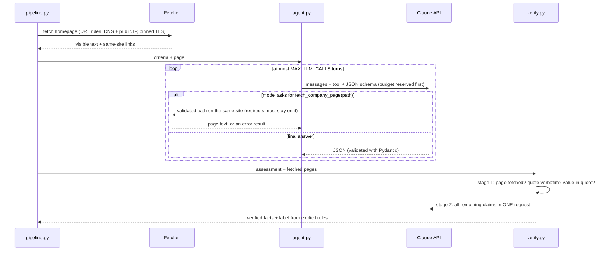

# Architecture

A single FastAPI process. There is no database, queue, vector store or user accounts: the
MVP keeps finished runs in memory with explicit limits.

## Flow for one company

## Backends

| Backend | Agent loop | Evidence check | Billing |
|---|---|---|---|
| `mock` | our loop (`agent.py`) over a keyword-rule stand-in | same stand-in | none |
| `anthropic` | our loop over `messages.create` (Anthropic API) | `messages.create` | per token |
| `claude_code` | inside Claude Code (Agent SDK), our tool as an in-process MCP server | one-turn Claude Code call through a `messages.create` adapter | Claude subscription |

All three use the same prompts, schemas, fetcher, evidence rules and budgets. A backend
never switches to another one on its own.

## Modules

| Module | Responsibility |
|---|---|
| `netguard.py` | URL rules, IP classification, DNS resolution with public-address checks |
| `fetcher.py` | `PageFetcher` interface and `HttpFetcher`: pinned connections, redirects, retries, size and time limits |
| `fixtures.py` | `FixtureFetcher`: saved pages from memory (tests, evaluation) |
| `html_text.py` | visible text, title, meta description, same-site links, delimiter neutralisation |
| `prompts.py` | system prompts and how untrusted text is embedded |
| `agent.py` | the agent loop: structured output, tool calls, every stop reason handled |
| `tools.py` | `fetch_company_page`: definition, argument validation, execution |
| `verify.py` | two-stage evidence verification and the label rules |
| `llm.py` | client creation per backend, retries, user-safe error messages |
| `claude_code.py` | the `claude_code` backend: locked-down Claude Code options, our tool as an MCP server, limits, subscription-limit handling |
| `budget.py` | per-company and per-run token and request budgets |
| `pipeline.py` | per-company orchestration and bounded concurrency |
| `web.py`, `templates/`, `static/` | form, results table, exports, JSON API, in-memory run store, access middleware |
| `demo.py` | public-demo protection: session cookie, rate limiter, daily budget |
| `export.py` | JSON and CSV export, CSV formula protection |
| `fake_llm.py` | mock client: returns real SDK message objects built from keyword rules |
| `evaluate.py`, `metrics.py`, `pricing.py`, `eval_dataset.py` | offline evaluation |

## Structured output

`Assessment` (Pydantic) defines the answer: name, description, industry, own locations,
markets served, a status per criterion, the exclusion flag, a label, a rationale and
evidence items (`supports`, `claim`, `url`, `quote`).

- The SDK's `transform_schema` turns the model into a JSON Schema that the API accepts.
  It forces `additionalProperties: false` and moves limits the API does not support,
  such as `maxLength`, into field descriptions.
- The schema is sent as `output_config.format`, so the API constrains the final answer to
  that shape.
- The reply is validated again with Pydantic, which also enforces the length limits. A
  reply that fails is reported as `invalid_output` and counted in the evaluation.
- Replies are read block by block by type: a response may begin with thinking blocks.

## Tool calling

`fetch_company_page` takes only `path`, and the tool is marked `strict` so the API keeps
its arguments to the schema. The code still validates every call:

- the path must start with a single `/`, with no domain, no embedded URL, no spaces,
  control characters or backslashes, and at most 200 characters;
- the path is joined to the homepage origin, never resolved against model-supplied URLs;
- it is fetched with `same_site_as=<homepage host>`, so each redirect hop must stay on
  the site (`www.` variants allowed). Public-IP checks run on every hop;
- every call counts toward `MAX_TOOL_CALLS`, invalid ones too. All results of one turn go
  back in a single message, with `is_error` on failures. Assistant turns, thinking blocks
  included, are passed back unchanged.

On the last allowed turn `tool_choice` is `none`. That forbids tool calls but does not
guarantee a usable answer, so every way a turn can end is handled explicitly:

| Turn ends with | Result |
|---|---|
| valid JSON | continue to verification |
| invalid JSON or schema violation | `invalid_output` |
| `max_tokens` (cut off) | `invalid_output` |
| `refusal` | `refused` (no fallback to another model) |
| a tool call after tools were disabled, other stop reasons | `invalid_output` |
| budget would be exceeded | `budget_exceeded`, nothing sent |
| API error after retries | `llm_error` |

## Evidence verification and label rules

**Stage 1, code.** The cited URL must be a fetched page and the quote must be verbatim on
it. Matching ignores case, whitespace and typographic quotes and dashes. For names and
places, the value must appear in the quote.

**Stage 2, one request.** The remaining claims and their quotes go to the verifier with
its own prompt and schema. The code writes the claim texts, for example *"The company
itself is located in X: it has its headquarters, an office, a plant or another facility
of its own there"*, so a market statement cannot pass as a location. The verifier only
sees quotes, never whole pages. It is an LLM too and can be wrong: "supported" means "a
second check agreed", not proof. A missing verdict counts as not supported.

**Rules.**

- A fact stays only if its claim is supported.
- A criterion keeps `met` or `not_met` only if its facts were verified; otherwise it
  becomes `unknown`.
- Geography uses own locations only.

| Verified situation | Label |
|---|---|
| an exclusion is supported | `non_fit` |
| any criterion is `not_met` | `non_fit` |
| all three criteria `met`, no exclusion reported | `fit` |
| anything else (missing, vague or unverified facts) | `insufficient_information` |

The model's own label is kept as `model_fit` and its raw answer as `raw_assessment`, for
transparency and evaluation.

## Budgets, retries and errors

- Before each API attempt the worst case is **reserved**: estimated input tokens
  (pessimistically, about 3 characters per token) plus `max_tokens`. The call is refused
  if the reservation would exceed the company or run budget. Afterwards the reservation
  is replaced by the reported usage.
- Agent turns, the evidence check and retries all count.
- SDK retries are switched off (`max_retries=0`). The app retries connection errors,
  timeouts, 408, 409, 429 and 5xx up to `LLM_MAX_RETRIES` times, honours `retry-after`
  up to 30 s, and counts each attempt.
- Spend-limit errors are never retried and stop the whole run: the SDK's
  `EnforcedSpendLimitReachedError` (429) and the 400 "usage limits" response for a custom
  limit.
- Error messages shown to users are written by the app and never include request headers
  or keys.
- An evaluation run gets the sum of the per-company caps, because each case is a separate
  one-company screening. The per-run caps are sized for one web screening of up to
  `MAX_URLS_PER_REQUEST` companies.

## Claude Code backend

Requirements: Claude Code installed and logged in with a Claude subscription, and the
optional extra (`uv sync --extra claude-code`), which installs the Agent SDK and its
bundled CLI. For personal local use only: Anthropic does not allow offering claude.ai login
or subscription rate limits in products for other people.

- **Authentication.** It is left to the Claude Code CLI; the app never reads credential
  files. `--bare` is not used, because it accepts only API keys. If `ANTHROPIC_API_KEY`,
  `ANTHROPIC_AUTH_TOKEN`, `ANTHROPIC_BASE_URL` or a cloud-provider switch is set, the
  backend refuses to start: in print mode Claude Code would use that instead of the
  subscription. The session's `apiKeySource` is logged (only the source name); the first
  real run reported `none`, meaning no API key was used.
- **Locked down.** The agent is limited to what it needs:
  - `tools=[]`: no built-in tools;
  - `strict_mcp_config=True`: only the app's own MCP server, none of the user's;
  - `setting_sources=[]`: no user, project or local settings, hooks, plugins or
    CLAUDE.md;
  - `permission_mode="dontAsk"`: nothing prompts, anything not pre-approved is denied;
  - `--no-session-persistence` and `--disable-slash-commands`;
  - the app's own system prompt and an empty working directory.

  In the first real run the session listed only `StructuredOutput` and
  `mcp__screener__fetch_company_page` as tools.
- **Tool.** `fetch_company_page` runs in the app's process, through the same code as the
  API backend: path validation, SSRF checks, the same-site rule and the call limit.
- **Output.** `output_format` with the `Assessment` schema; Claude Code validates and
  re-prompts, then the app validates again with Pydantic. Turn-limit and schema-retry
  failures become `invalid_output`.
- **Limits.** `CLAUDE_CODE_MAX_TURNS` per run, `CLAUDE_CODE_TIMEOUT_S` per run, and
  `CLAUDE_CODE_CONCURRENCY` processes at once. Budgets reserve a turn before each run and
  are charged with the reported usage, counting every turn as a request.
- **Subscription limit.** A rate-limit event with status `rejected`, any paid `overage`,
  or a `rate_limit` / `billing_error` reply stops the stream and the whole run. The
  message names the window and its reset time; nothing switches to the API.

## Page fetching and SSRF protection

- **URL rules.** http/https only; ports 80 and 443 only; no credentials in URLs; no IP
  literals, including tricks such as `2130706433` or `0x7f.1`; no `localhost`,
  `.local`, `.internal`, `.example` or other reserved names.
- **Addresses.** The host name is resolved by the app. Every returned address must be
  public, so one private answer blocks the name. `is_global` alone is not enough: it is
  true for multicast and for NAT64 forms of loopback, so both are checked explicitly.
- **Pinned connection.** The request goes to the checked IP with the original `Host`
  header and `sni_hostname`. TLS still verifies the certificate for the real name, and
  DNS rebinding between check and connect has no effect.
- **Redirects** are followed manually. Each hop repeats the URL rules, the DNS checks
  and, for tool calls, the same-site rule.
- **Other protections:**
  - `trust_env=False`, so proxy variables cannot bypass the checks;
  - no keep-alive, so a TLS session verified for one name is not reused for another;
  - no compression requested;
  - 2 MB size limit;
  - only HTML and text content types;
  - per-phase timeouts plus a total limit per page that includes retries;
  - retries only for temporary errors, and the next checked address is tried when a
    connection fails.

## Prompt injection

Website text is untrusted. Hidden elements (`display:none`, `hidden`, `aria-hidden`) are
removed during extraction, and delimiter tags inside page text are neutralised. That is
hygiene, not protection: a model can still be influenced by visible text. The protections
that do not depend on the model obeying instructions are:

- the model has one tool, it can only read pages of the same site, and code validates
  its arguments;
- turns, tool calls, requests and tokens are capped in code;
- facts need verbatim quotes from fetched pages and a second check;
- the label is computed by code from verified facts.

The evaluation set has a visible injection, a hidden one and an off-site redirect.

## Storage and concurrency

- Runs are kept in memory:
  - at most `MAX_STORED_RUNS`, with the oldest finished runs dropped first and running
    runs never dropped;
  - finished runs expire after `RUN_TTL_S`;
  - at most `MAX_ACTIVE_RUNS` run at once, otherwise the form and the API answer 429.
- Within a run, `CONCURRENCY` companies are processed in parallel.
- The results page refreshes itself with `<meta http-equiv="refresh">`, without JavaScript.

## Public demo protection

These checks are active only when `DEMO_ACCESS_TOKEN` is set. `PUBLIC_DEMO=true` makes the
token mandatory and refuses the `claude_code` backend at startup.

- **Access.** A middleware lets through only `/healthz`, `/login` and static files.
  Everything else needs one of:
  - the session cookie: an HMAC of a fixed label keyed with the token, so the cookie never
    contains the token; HttpOnly, SameSite=Lax, Secure when `COOKIE_SECURE=true`;
  - a `Bearer` header with the token.

  Without access, pages redirect to `/login`, while the API and exports answer 401.
  Comparisons use `hmac.compare_digest`.
- **Rate limits.** Sliding windows per client IP:
  - `LOGIN_ATTEMPTS_PER_IP_PER_15_MIN` for login attempts;
  - `RUNS_PER_IP_PER_HOUR` for screenings.

  Behind a reverse proxy the client IP comes from `X-Forwarded-For`, which uvicorn trusts
  only because the container port is bound to loopback.
- **Daily budget.** `DAILY_MAX_COMPANIES` and `DAILY_MAX_TOKENS` apply per UTC day.
  - A run first reserves `min(MAX_TOKENS_PER_RUN, tokens left today)`; that becomes its
    token cap.
  - When the run ends, the reservation is replaced by the tokens it actually used.
  - So concurrent runs cannot overspend the day.
- **Where the limits live.** All counters are in memory: one process, reset on restart.
  The provider's workspace spend limit stays the outer line of defence.
